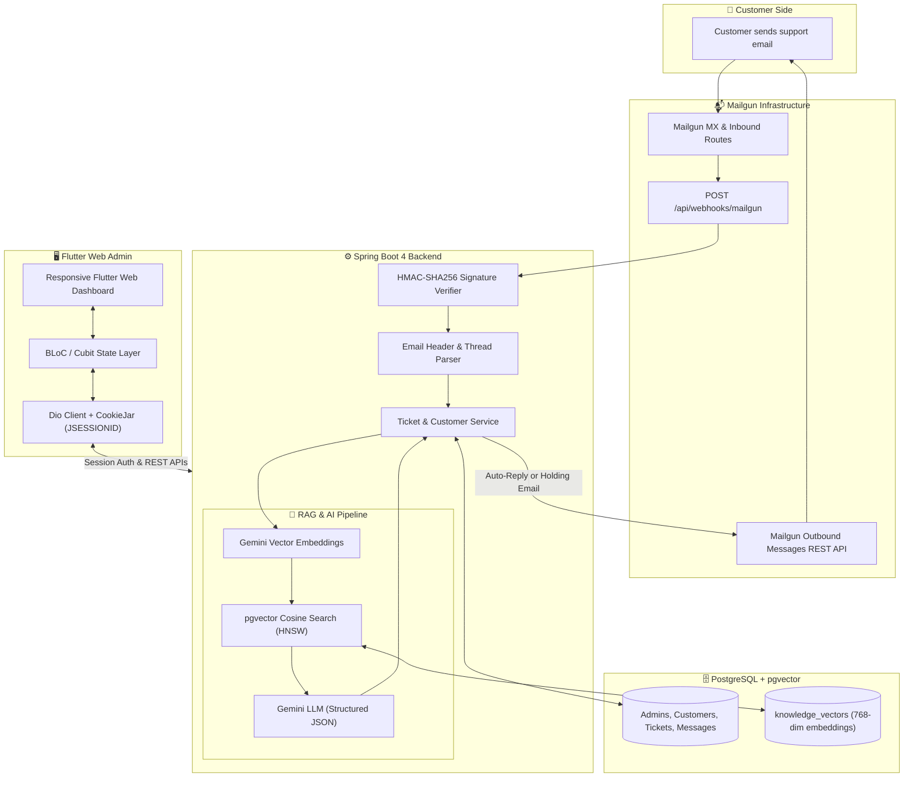
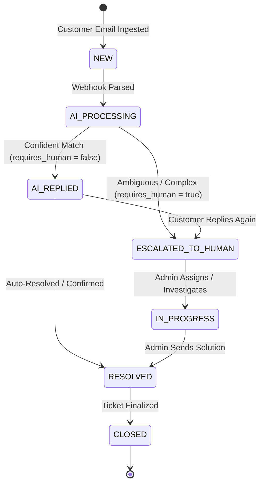

# AI Helpdesk — Autonomous Customer Management System

[](https://openjdk.org/)
[](https://spring.io/projects/spring-boot)
[](https://spring.io/projects/spring-ai)
[](https://github.com/pgvector/pgvector)
[](https://flutter.dev/)
[](https://bloclibrary.dev/)
[](https://www.mailgun.com/)
[](LICENSE)

An enterprise-grade **AI-powered Customer Management & Helpdesk System** featuring automated inbound email ingestion via Mailgun, autonomous triage and retrieval-augmented generation (RAG) using Google Gemini and PostgreSQL `pgvector`, smart escalation routing, and a responsive Flutter Web admin dashboard built with Material 3.

---

## 📸 Application Screenshots

### 1. Customer Support Overview (Telemetry & Triage)
Comprehensive real-time telemetry displaying key performance indicators (KPIs), AI resolution rates, escalation queue, recent customer interactions, and category volume distributions.


### 2. Live Ticket Triage & Conversation Thread
Three-pane operational desk showing ticket queue filters, full email conversation history, Google Gemini Markdown auto-replies, human agent response composer, and ticket metadata inspection.


---

## 🌟 Key Features

- **📧 Automated Email Ingestion & Threading:**
  - Ingests inbound customer support emails via Mailgun Webhook routes (`/api/webhooks/mailgun`).
  - Verifies webhook signatures using HMAC-SHA256 with timestamp verification.
  - Automatically handles email conversation threading using `In-Reply-To` and `References` headers.

- **🧠 Domain-Specific RAG Pipeline:**
  - Ingests and parses `knowledge_base.md` upon application startup.
  - Generates dense vector embeddings via Google Gemini (`gemini-embedding-001` / `text-embedding-004`).
  - Stores and retrieves relevant knowledge chunks using PostgreSQL `pgvector` with cosine distance and HNSW indexing.

- **🤖 Structured AI Decision Making:**
  - Leverages Google Gemini structured JSON output for strict schema compliance:
    - Contextual auto-reply drafting formatted in Markdown.
    - Automatic ticket classification (`BILLING`, `TECHNICAL`, `ACCOUNT`, `GENERAL`, `UNKNOWN`).
    - Human escalation assessment (`requires_human: boolean`) and root-cause reason tracking.

- **🔄 Intelligent Ticket Lifecycle & Escalation:**
  - Auto-resolves routine queries (`AI_REPLIED`) with zero human intervention.
  - Gracefully escalates complex queries (`ESCALATED_TO_HUMAN`) and delivers holding notices.
  - **Edge-case safety:** If a customer replies to an auto-answered ticket, the system automatically transitions the ticket to human escalation.

- **💻 Responsive Flutter Web Dashboard:**
  - Optimized for desktop multi-pane views (>900px) as well as tablet and mobile layouts.
  - Enterprise Material 3 design tokens, color-coded status badges, and sparkline trends.
  - Renders AI responses with GitHub-flavored Markdown formatting.

- **🔒 Enterprise Session Security:**
  - Single-admin session management using HTTP-only cookies (`JSESSIONID`).
  - Native support for Chrome Partitioned cookies (CHIPS) and cross-origin SameSite policies.
  - Transparent session cookie preservation on Flutter Web using `dio_cookie_manager` and `CookieJar`.

- **⚡ Zero-Overhead Manual Refresh UX:**
  - Strictly follows a manual refresh architecture (Refresh button & Pull-to-Refresh).
  - Eliminates server strain, persistent WebSocket connections, or battery-draining polling loops.

---

## 🏛️ System Architecture



---

## 🔄 Ticket Lifecycle State Machine



---

## 🛠️ Technology Stack

| Layer | Technologies |
|---|---|
| **Backend Framework** | Java 17, Spring Boot 3.4 / 4.x, Spring Web |
| **Security & Session** | Spring Security, HTTP-only Cookie (`JSESSIONID`), Partitioned SameSite Filter |
| **Database & Vector Store** | PostgreSQL 16+, `pgvector` extension (768-dimension HNSW cosine indexing), Flyway |
| **AI / LLM Integration** | Spring AI (`spring-ai-starter-model-google-genai`), Google Gemini 1.5 Pro / Flash |
| **Email Infrastructure** | Mailgun Inbound Webhooks (HMAC-SHA256 signature verification), Mailgun REST API |
| **Frontend Framework** | Flutter Web (Dart 3.x), Material Design 3 |
| **State Management** | `flutter_bloc` / Cubit |
| **HTTP & Networking** | `dio`, `cookie_jar`, `dio_cookie_manager` |
| **Routing & UI** | `go_router`, `responsive_builder`, `flutter_markdown_plus`, `intl` |
| **Code Generation** | `freezed`, `json_serializable`, `build_runner` |

---

## 📂 Project Directory Structure

```text
customer-management-system/
├── backend/                              # Spring Boot Java 17 Application
│   ├── src/main/java/com/rajkumartimalsina/backend/
│   │   ├── admin/                        # Admin entity, repository, and initial seeder
│   │   ├── ai/                           # Spring AI Gemini service & RAG orchestration
│   │   ├── auth/                         # Session authentication & cookie controllers
│   │   ├── common/                       # CORS, Security, PartitionedCookieFilter, Exceptions
│   │   ├── customer/                     # Customer profile entities and CRUD services
│   │   ├── email/                        # Mailgun REST API sender implementation
│   │   ├── knowledge/                    # Vector ingestion & knowledge base markdown parser
│   │   ├── message/                      # Ticket message history & sender types
│   │   ├── ticket/                       # Ticket lifecycle, categorization, and statistics
│   │   └── webhook/                      # Mailgun inbound webhook controller & HMAC verifier
│   ├── src/main/resources/
│   │   ├── application.properties        # Backend configuration
│   │   ├── knowledge_base.md             # Vectorized knowledge base documentation
│   │   └── db/migration/                 # Flyway SQL migration scripts
│   ├── Dockerfile                        # Multi-stage production container build
│   └── pom.xml                           # Maven dependencies & plugins
│
├── frontend/                             # Flutter Web & Responsive Client
│   ├── lib/
│   │   ├── core/                         # Network client, Dio CookieJar, theme tokens, router
│   │   └── features/
│   │       ├── auth/                     # Admin login page, Cubit, and session verification
│   │       └── tickets/                  # Overview telemetry, ticket list, detail pane, BLoC
│   ├── web/                              # Web entry point, manifest, and icons
│   └── pubspec.yaml                      # Flutter dependencies
│
├── screenshots/                          # Application screenshots showcased in README
│   ├── Screenshot 2026-11-17 110517.jpg  # Customer Support Overview dashboard
│   └── Screenshot 2026-11-17 110638.jpg  # Ticket Detail & Conversation View
│
├── .env.example                          # Environment variables template
├── PROJECT_PLAN.md                       # Comprehensive project design document
├── RULES.md                              # Core architectural constraints
└── README.md                             # Root documentation (this file)
```

---

## 🚀 Getting Started

### Prerequisites

Ensure you have the following installed locally:
- [Java Development Kit (JDK) 17+](https://adoptium.net/)
- [Maven 3.9+](https://maven.apache.org/) (or use the included `./mvnw`)
- [Flutter SDK 3.13+](https://docs.flutter.dev/get-started/install)
- [PostgreSQL 16+](https://www.postgresql.org/) with the [`pgvector`](https://github.com/pgvector/pgvector) extension installed
- A [Google Gemini API Key](https://aistudio.google.com/)
- A [Mailgun Account](https://www.mailgun.com/) (API key, sending domain, and webhook signing key)

---

### 1. Database Setup

Create the PostgreSQL database and enable `pgvector`:

```sql
CREATE DATABASE customer_management_db;
\c customer_management_db;
CREATE EXTENSION IF NOT EXISTS vector;
```

---

### 2. Backend Configuration & Startup

1. Navigate to the backend directory:
   ```bash
   cd backend
   ```

2. Create your environment configuration file:
   ```bash
   cp .env.example .env
   ```

3. Populate `.env` with your credentials:
   ```properties
   # Database
   SPRING_DATASOURCE_URL=jdbc:postgresql://localhost:5432/customer_management_db
   SPRING_DATASOURCE_USERNAME=postgres
   SPRING_DATASOURCE_PASSWORD=your_postgres_password

   # Admin Credentials (Seeded on first startup)
   ADMIN_INITIAL_USERNAME=admin
   ADMIN_INITIAL_PASSWORD=Admin@123456

   # Google Gemini API
   GEMINI_API_KEY=your_gemini_api_key_here
   GEMINI_CHAT_MODEL=gemini-1.5-pro
   GEMINI_EMBEDDING_MODEL=text-embedding-004

   # Mailgun Configuration
   MAILGUN_API_KEY=your_mailgun_api_key_here
   MAILGUN_DOMAIN=support.yourdomain.com
   MAILGUN_BASE_URL=https://api.mailgun.net
   MAILGUN_FROM_EMAIL=support@support.yourdomain.com
   MAILGUN_WEBHOOK_SIGNING_KEY=your_mailgun_webhook_signing_key_here

   # CORS & Cookie
   CORS_ALLOWED_ORIGINS=http://localhost:3000,http://localhost:8080
   SESSION_COOKIE_SAME_SITE=lax
   SESSION_COOKIE_SECURE=false
   ```

4. Build and start the Spring Boot server:
   ```bash
   # Unix / macOS
   ./mvnw clean spring-boot:run

   # Windows PowerShell
   .\mvnw.cmd clean spring-boot:run
   ```

   The backend will start at `http://localhost:8080`. On boot, the knowledge base is automatically ingested and embedded into the database.

---

### 3. Frontend Setup & Startup

1. Navigate to the frontend directory:
   ```bash
   cd frontend
   ```

2. Install dependencies:
   ```bash
   flutter pub get
   ```

3. (Optional) Rebuild generated Freezed and JSON models:
   ```bash
   flutter pub run build_runner build --delete-conflicting-outputs
   ```

4. Launch the Flutter Web client:
   ```bash
   flutter run -d chrome --web-port=3000
   ```

5. Log in with the initial admin credentials:
   - **Username:** `admin`
   - **Password:** `Admin@123456`

---

## 📡 REST API Reference

### Authentication
| Method | Endpoint | Description | Auth Required |
|---|---|---|---|
| `POST` | `/api/auth/login` | Validates admin credentials & sets `JSESSIONID` | No |
| `POST` | `/api/auth/logout` | Invalidates session & clears auth cookie | Yes |
| `GET` | `/api/auth/session` | Checks active session status | No |
| `GET` | `/api/auth/me` | Retrieves logged-in admin profile | Yes |

### Tickets & Triage
| Method | Endpoint | Description | Auth Required |
|---|---|---|---|
| `GET` | `/api/tickets` | Paginated ticket queue with search and status/category filters | Yes |
| `GET` | `/api/tickets/{id}` | Complete ticket details with conversation thread | Yes |
| `PATCH` | `/api/tickets/{id}/status` | Updates ticket lifecycle status | Yes |
| `PATCH` | `/api/tickets/{id}/category` | Updates ticket category | Yes |
| `POST` | `/api/tickets/{id}/messages` | Human agent sends reply via Mailgun API | Yes |
| `GET` | `/api/tickets/stats` | KPI telemetry (counts, resolution rate, category breakdown) | Yes |

### Customers
| Method | Endpoint | Description | Auth Required |
|---|---|---|---|
| `GET` | `/api/customers` | Lists customer profiles | Yes |
| `GET` | `/api/customers/{id}` | Gets customer details and associated ticket history | Yes |

### Webhooks
| Method | Endpoint | Description | Auth Required |
|---|---|---|---|
| `POST` | `/api/webhooks/mailgun` | Receives inbound customer emails (HMAC verified) | No (HMAC signed) |

---

## 🧪 Testing

### Running Backend Tests
Execute the comprehensive Spring Boot unit and integration tests:
```bash
cd backend
./mvnw test
```

Includes test suites for:
- Mailgun HMAC signature validation
- Knowledge base parsing & chunking
- Email header threading (`In-Reply-To`, `References`)
- Authentication & session management
- Ticket lifecycle validation & database persistence

### Running Frontend Tests
Execute the Flutter BLoC and widget tests:
```bash
cd frontend
flutter test
```

Includes test suites for:
- BLoC/Cubit state transitions (`AuthCubit`, `TicketListCubit`, `TicketDetailCubit`)
- Dio `CookieJar` session persistence
- Responsive multi-pane layout breakpoints

---

## 🚢 Production Deployment Notes

1. **Cross-Origin Cookies (Render & Firebase):**
   - When hosting frontend (e.g. Firebase Hosting) and backend (e.g. Render) on different subdomains, configure:
     - `SESSION_COOKIE_SAME_SITE=none`
     - `SESSION_COOKIE_SECURE=true`
     - `SESSION_COOKIE_DOMAIN=yourdomain.com`
     - `CORS_ALLOWED_ORIGINS=https://app.yourdomain.com`

2. **Mailgun Webhooks:**
   - In the Mailgun dashboard, configure an **Inbound Route**:
     - **Expression:** `match_recipient("support@yourdomain.com")`
     - **Actions:** `forward("https://api.yourdomain.com/api/webhooks/mailgun")` and `store()`

3. **Docker Deployment:**
   - The backend contains a production-ready multi-stage `Dockerfile`:
     ```bash
     docker build -t ai-helpdesk-backend backend/
     docker run -p 8080:8080 --env-file backend/.env ai-helpdesk-backend
     ```

---

## 📄 License

This project is licensed under the [MIT License](LICENSE).
